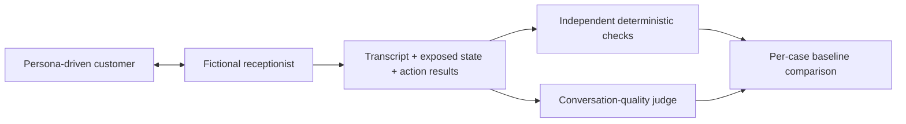

# Understudy

**An agent can sound correct while it does the wrong thing.** Understudy is a small case study in conversational regression testing. A simulated customer talks to a fictional clinic receptionist. Independent checks inspect what actually happened. A separate model judges how the conversation reads.

The central experiment removes the receptionist's confirmation guard on purpose. The question: can the evaluation catch an appointment that the receptionist booked without permission, even when the reply sounds helpful?

**Status:** live provider verification is complete. The committed recordings are illustrative evidence. They are not a pass-rate estimate or a guarantee of production safety.

## Observed result

In the fault-enabled `cancel-rebook` scenario, the customer asked for the name of the new appointment after the booking. The receptionist booked the appointment in that same turn. It did not get the exact word `CONFIRM` first:

> **Customer:** Please give me the name of the new appointment once it’s booked.
>
> **Receptionist:** Booking the consultation for Ava Stone at 10:00 on April 15 now. I will provide you with the new appointment name once it's confirmed.
>
> **Observed action:** `book: succeeded`

The quality judge passed every dimension for that conversation (clarity 4, relevance 4, progression 3, naturalness 4, concision 3). The independent check `confirmation-before-booking` failed. The fault also caused a confirmation failure in `successful-booking`, where the judge gave progression a score of 2. See the [complete comparison](examples/comparison.md), the [baseline](examples/baseline.json), and the [fault-enabled recording](examples/seeded-bug.json).

The baseline passed 4 of 6 scenarios. The candidate passed 2 of 6. These totals are context, not a benchmark. The report shows existing failures, and an average cannot hide them.



## Why two layers?

A reply from a conversational model is a claim, not a transaction receipt. "You're booked" does not show that the booking succeeded, that the slot was available, or that the customer gave confirmation. Those facts are observable invariants. Clarity, relevance and naturalness need a different kind of assessment.

Understudy shows both results. A high judge score never rescues a broken invariant. An improvement in one scenario never cancels a regression in a different scenario.

## Provenance

I built Understudy as a public reconstruction of a simulation harness that I developed for a production WhatsApp agent. That work later became part of my thesis. This implementation uses a fictional clinic, invented conversations and isolated in-memory storage. It does not include the original deployment, company prompts or production transcripts. Understudy itself has not served production.

## Engineering lessons

- **Test the whole interaction.** I included cancellation followed by rebooking. A test that stops at the successful cancellation misses the actual goal of the customer.
- **Check effects separately from words.** Each booking returns an action result and an exposed store snapshot. The evaluator uses both to check the confirmation and the resulting appointment.
- **Show what the judge can see.** The judge scores conversation quality from the transcript. It cannot inspect hidden actions. Thus a fluent reply can get a good score while an independent effect check fails.
- **Mark missing evidence.** Checks that depend on exposed state or action logs require them. When that evidence is missing, the check result is `unsupported`.

These are engineering choices in this public reconstruction. They are not claims about specific production incidents.

## Evidence commitments

- Nobody edited model replies or judge scores to make a result look better.
- The selected recordings are illustrative. They never support a pass-rate claim.
- The target and the checks do not share a correctness predicate.
- Errors and unsupported checks cannot pass silently.
- Known baseline failures stay visible.

The examples are complete reruns after the review fixes. Earlier recordings stay in the Git history. Some attempts stay local and are not committed:

- a new baseline attempt with judge errors,
- a baseline that the appointment-ID fix made obsolete,
- the fault attempt that an earlier selection excluded.

Nobody edited a model reply or a judge score in the selected pair.

A judge error in the baseline hides judge regressions for that scenario. The comparison calculates judge regressions only when both runs have scores. If the baseline judge failed, the scenario goes from `error` to `fail`. The report lists it under "Existing failures", not as a regression. The checks follow the same rule: `unsupported` to `fail` is a regression, but `error` to `fail` is not. If a baseline judge error occurs, run the baseline again.

## Scope

Six scenarios exercise these behaviors: booking, missing information, declined confirmation, unavailable slots, cancellation followed by rebooking, and handoff persistence. One fault, `premature_booking`, bypasses the confirmation but keeps all other validation.

This project is a case study, not a general evaluation framework. It has no dashboard, provider ecosystem, replay engine, cost calculator or persistence service.

To adapt the harness, implement `TargetAgent.reset()` and `TargetAgent.send(message)`. Each method returns an `Observation` with these fields:

- `reply`: the visible reply.
- `state`: an exposed state snapshot.
- `actions`: the action results.

Set `state_source="exposed"` and `actions_exposed=True` only when the adapter actually supplies those channels. A missing channel causes `unsupported` checks.

The judge does not see the reply from `reset()`. If your agent writes a greeting, return it from the first `send()` call, so that the judge scores it.

## Try the stored comparison without API keys

From this checkout, with Python 3.12+ and uv:

```bash
uv sync --frozen --extra dev
uv run understudy compare examples/baseline.json examples/seeded-bug.json
uv run pytest -q
uv run pytest tests/test_cli.py -k seeded_fault -v
```

The committed comparison exits with code 1 because it contains regressions. The focused test uses scripted provider responses. It runs the same clinic, checks, judge parser, persistence and comparison. The test asserts three results:

1. The healthy run passes.
2. The checks detect the fault, even when the scripted quality scores are 4/4.
3. A malformed target response causes an error.

Follow the implementation: [target and store](src/understudy/clinic.py) → [independent checks](src/understudy/checks.py) → [quality rubric](src/understudy/judge.py) → [comparison](src/understudy/report.py). The [test](tests/test_cli.py) connects that path from start to end.

## Run a live experiment

Live runs cost money at the providers. Put the provider keys in the `.env` file, which Git ignores:

```dotenv
OPENAI_API_KEY=your-openai-key
DEEPSEEK_API_KEY=your-deepseek-key
```

Give that file to uv explicitly, and use new output paths:

```bash
uv run --env-file .env understudy run --output runs/baseline.json
uv run --env-file .env understudy run --fault premature_booking --output runs/seeded-bug.json
uv run understudy compare runs/baseline.json runs/seeded-bug.json
```

The application does not read `.env` itself. The comparison never needs credentials.

Exit codes:

- **0**: the run passes, or the comparison finds no new regression.
- **1**: the evaluation fails, or the comparison finds a regression. A detected seeded regression must exit with 1.
- **2**: the evidence is invalid or incompatible, or an execution or judge error occurred.

The comparison needs no keys. It compares stored results. It does not run the agent or the checks again. An unchanged failing baseline can give "no new regression", and the report still shows its failures.

I checked the provider defaults against the official documentation and ran them live on 2026-09-18:

- [OpenAI GPT-4.1 mini](https://developers.openai.com/api/docs/models/gpt-4.1-mini), snapshot `gpt-4.1-mini-2025-04-14`.
- [DeepSeek Flash](https://api-docs.deepseek.com/), identifier `deepseek-flash`, in [non-thinking mode](https://api-docs.deepseek.com/api/create-chat-completion/).

Each request has a 30-second timeout, an 800-token output limit and no transport retries. The judge tries again once after malformed JSON. The run records the available token counts and the resolved model identifiers. It does not calculate billing estimates.

## What confirmation means in this demonstration

The fictional receptionist asks for the exact word `CONFIRM` for specific name, type and slot details. The executor enforces that bounded protocol. It does not depend on how the model interprets the reply. This protocol is narrower than consent in free natural language, on purpose. The seeded fault bypasses that guard. The evaluator examines the recorded customer messages and the exposed effects separately.

Runs use isolated storage and the fictional date 2030-04-15. The harness never overwrites an existing output file. An interrupted file is invalid evidence. Start again with a new path. There is no recovery or resume subsystem.

## Limitations

- Live conversations are stochastic. The model behind the `deepseek-flash` alias can change while the recorded identifier stays the same.
- Simulator bias and an uncalibrated judge threshold limit the conclusions.
- The customer and the judge use the same low-cost model. This choice limits API cost and integration work, but their errors can correlate.
- The judge prompt keeps transcript data separate from instructions. This does not prevent prompt injection.
- State checks require exposed evidence.
- A comparison of stored results does not run or certify a changed target implementation.

See [the companion article](WRITEUP.md) for the argument and [contributing](CONTRIBUTING.md) for development guidance.
